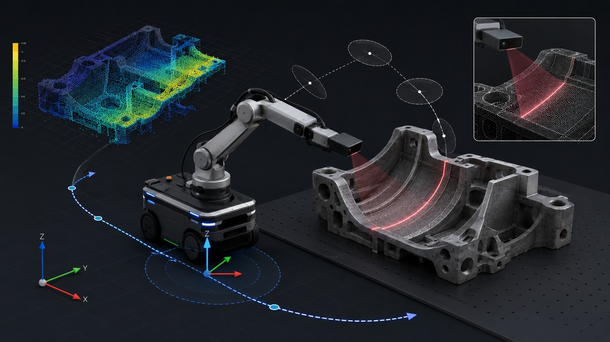

# Muhammed Elyamani

**PhD researcher in robotics and control · Perception-aware motion planning**

  

*An example application of perception-aware motion planning. This conceptual illustration shows a sensing and mobile-manipulation scenario; sensor and robot choices depend on the task.*

I study how robots should move to acquire useful information and accomplish tasks. My interests connect sensing quality and uncertainty with motion feasibility, coverage, and task objectives. RGB-D and hyperspectral sensing are initial application interests, within a broader direction open to different sensors and robot platforms.

## Research layers

**Sense → represent and estimate → plan → execute → sense again**

The projects below develop components of this research direction. Integrating them into a perception-aware planning system is ongoing work.

<table>
<tr>
<td width="50%" valign="top">

### 1 · Sensing and perception

**What can the robot observe?**

[Husky Gazebo Image Capture](https://github.com/WikiGenius/husky-gazebo-image-capture) — ROS2 simulation tools for collecting images and odometry.

[ROS Husky Traffic Sign Detection](https://github.com/WikiGenius/ros-husky-traffic-sign-detection) — an earlier ROS 1 semantic-perception demo.

**Research connection:** observations and task-relevant information provide the basis for evaluating sensing opportunities.

</td>
<td width="50%" valign="top">

### 2 · Representation and estimation

**What does the robot know about the scene?**

[NeRF Lab](https://github.com/WikiGenius/nerf-lab) — camera geometry, neural density learning, and opacity/depth rendering with known poses.

Supporting work: [GTSAM SLAM Vision](https://github.com/WikiGenius/GTSAM_SLAM_VISION), with visual pose-estimation and factor-graph experiments.

**Research connection:** scene and pose models can support visibility reasoning and planning under uncertainty.

</td>
</tr>
<tr>
<td width="50%" valign="top">

### 3 · Motion planning and geometry

**Where and how should the robot move?**

[Wheeled Mobile Manipulator Planning and Tracking](https://github.com/WikiGenius/wmm-planning-and-tracking) — MATLAB trajectory generation, base–arm coordination, and tracking simulations.

Supporting work: [Screw Theory Toolkit](https://github.com/WikiGenius/RoboticScrewTheoryToolkit), with kinematics, Jacobians, and inverse kinematics.

**Research connection:** feasible trajectories and reachable sensing poses form a foundation for introducing perception objectives.

</td>
<td width="50%" valign="top">

### 4 · Control and task execution

**How does a motion decision become robot action?**

[ROS2 MoveIt Grasping Demo](https://github.com/WikiGenius/ros2-moveit-grasping-demo) — Cartesian approach, gripper control, and retreat from a target pose.

**Research connection:** feedback and execution connect planned motion to the observations and actions a robot can achieve.

</td>
</tr>
</table>

For the closest connection to my planning research, start with **[WMM Planning and Tracking](https://github.com/WikiGenius/wmm-planning-and-tracking)**, followed by **[NeRF Lab](https://github.com/WikiGenius/nerf-lab)**. Each repository documents its own setup and current limitations.

## Foundations and ongoing work

- **Classical control:** [iPendulum](https://github.com/WikiGenius/ipendulum) and [Cruise Control](https://github.com/WikiGenius/Cruise_control) cover feedback, modeling, and estimation foundations.
- **Learning and navigation:** [Control project index](https://github.com/WikiGenius/robotics-control-learning-labs), [ROS2 lab scaffold](https://github.com/WikiGenius/ros2-mobile-robotics-labs), and [research reading map](https://github.com/WikiGenius/research-reading-map).
- **Planned application:** [Line-scan mobile-manipulator scaffold](https://github.com/WikiGenius/line-scan-mobile-manipulator-demo) explores a possible scanning and coverage test case; a complete runnable demo is still planned.

Earlier computer-vision applications, including [StreetStat](https://github.com/WikiGenius/StreetStat) and [CrowdScope](https://github.com/WikiGenius/CrowdScope), document the development of my perception background.

## Collaboration

I welcome collaboration on perception-aware planning, sensing models, estimation, and reproducible robotics experiments. Open an issue in the relevant repository to discuss technical work.

**Tools:** Python · C++ · MATLAB/Simulink · ROS2 · MoveIt2 · Gazebo · GTSAM · PyTorch
