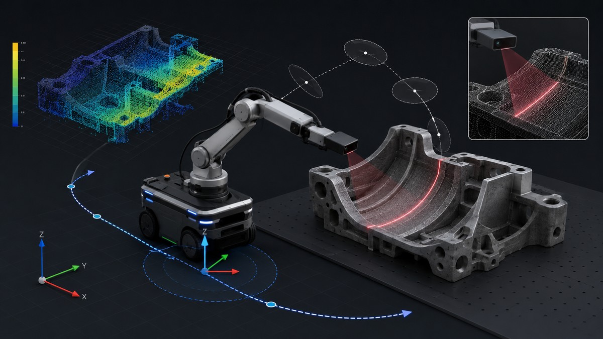

# Muhammed Elyamani

**PhD Researcher in Electrical Engineering (Control) · KFUPM**  
**Active Perception · Motion Planning · State Estimation · Control · Robotic Reasoning**

[Curriculum vitae (PDF)](assets/Muhammed_Elyamani_CV.pdf)

  

Conceptual illustration of research direction; not an experimental result or a validated integrated system.

## Research vision

My long-term goal is to develop **task-driven autonomous robotic systems** that integrate active perception, state estimation, motion planning, control, and reasoning. I am interested in how robots determine what information a task requires, select informative and physically feasible actions, and use new observations to improve subsequent decisions under uncertainty.

## Current PhD research

**Perception-Aware Motion Planning and Control for Robotic Sensing**

I investigate how sensing requirements influence robot motion and how motion affects observation quality. My current research question is: When does changing a sensing trajectory improve independently measured observation quality compared with a well-tuned geometric scanning baseline?

My current experimental plan begins with RGB area/virtual-line measurements using an OAK-D camera, with a planned transfer to RGB-D and pushbroom hyperspectral sensing for 3-D material mapping. These are testbeds for the broader research direction, not completed integrated demonstrations. Longer-term application interests include inspection, exploration, navigation, and manipulation.

## Selected projects

<table>
  <tr>
    <td width="50%" valign="top">
      
      
<strong><a href="https://github.com/WikiGenius/wmm-planning-and-tracking">Wheeled Mobile Manipulator Planning and Tracking</a></strong>

      
MATLAB planning, base–arm kinematic coordination, and reduced-coordinate dynamic tracking for a differential-drive mobile manipulator. Includes trajectory and disturbance-response studies.

      Motion planning · Nonholonomic systems · Control · Simulation-based
    </td>
    <td width="50%" valign="top">
      
      
<strong><a href="https://github.com/WikiGenius/nerf-lab">NeRF Lab</a></strong>

      
Camera geometry, ray sampling, neural density learning, and opacity/depth rendering. Controlled known-pose experiments—not a complete online NeRF-SLAM system.

      3-D perception · Camera geometry · Neural scene representation
    </td>
  </tr>
  <tr>
    <td width="50%" valign="top">
      
      
<strong><a href="https://github.com/WikiGenius/ros2-moveit-grasping-demo">ROS2 MoveIt Grasping Demo</a></strong>

      
C++/ROS2 motion-planning and gripper-control workflows for approach, grasp, and retreat. The public demo illustrates execution stages; hardware validation is not claimed.

      ROS2 · MoveIt2 · Manipulation · Existing demo GIF
    </td>
    <td width="50%" valign="top">
      
      
<strong><a href="https://github.com/WikiGenius/GTSAM_SLAM_VISION">GTSAM SLAM Vision</a></strong>

      
MATLAB visual pose-estimation and factor-graph experiments using tag observations and geometric constraints. A learning/research prototype, not a benchmarked full SLAM system.

      State estimation · Factor graphs · Visual geometry
    </td>
  </tr>
</table>

## Additional engineering work

<table>
  <tr>
    <td width="30%" valign="top">
      
    </td>
    <td width="70%" valign="top">
      <strong><a href="https://github.com/WikiGenius/reaction-wheel-control-lab">Reaction Wheel Control Lab</a></strong>
      
Physical EE 381 teaching prototype combining SolidWorks CAD, fabrication, electromechanical dynamics, and MATLAB control studies.

      
<a href="https://github.com/WikiGenius/reaction-wheel-control-lab/blob/main/evidence/videos/reaction-wheel-demo.gif">Watch the bench GIF</a> · <a href="https://github.com/WikiGenius/reaction-wheel-control-lab">Explore CAD and simulation results</a>

      Bench footage documents physical operation; simulated control performance is reported separately, not as measured hardware tracking.
    </td>
  </tr>
</table>

**Related foundations:** [Husky Gazebo image capture](https://github.com/WikiGenius/husky-gazebo-image-capture) (simulated sensing and odometry) · [Screw Theory Toolkit](https://github.com/WikiGenius/RoboticScrewTheoryToolkit) (kinematics and Jacobians) · [iPendulum](https://github.com/WikiGenius/ipendulum) (control exercises).

These repositories illustrate complementary **sensing, estimation, planning, and control** capabilities; they are not presented as a single integrated PhD system.

## Collaboration

I welcome technical discussions about active perception, motion planning and control, state estimation, task-driven robotic autonomy, and reproducible robotics experiments. For a project-specific question, please open an issue in the relevant repository.

**Technical stack across projects:** Python · C++ · MATLAB/Simulink · ROS 1/2 · MoveIt2 · Gazebo · GTSAM · PyTorch
